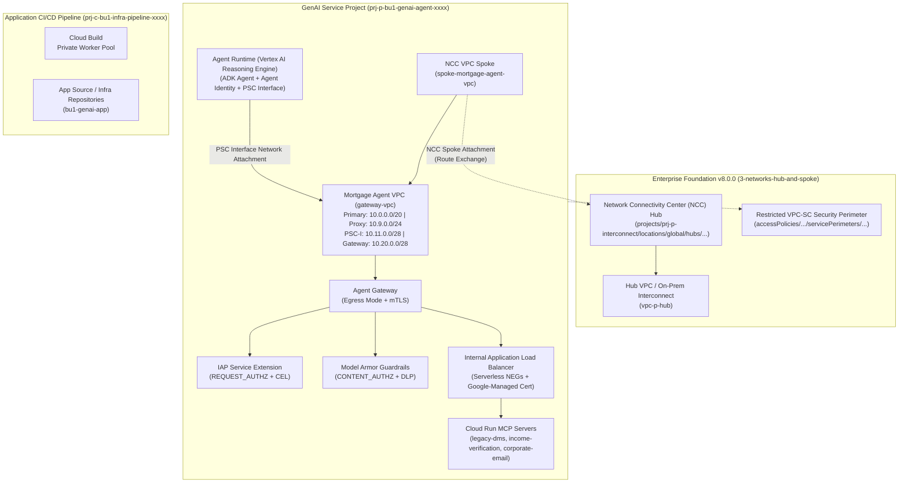

# Deploying Mortgage Agent on top of Terraform Example Foundation (v8.0.0 / Future v8 - Current Main)

These instructions explain how to deploy the [Gemini Enterprise Agent Platform](https://cloud.google.com/blog/products/ai-machine-learning/introducing-gemini-enterprise-agent-platform) reference implementation (**Mortgage Agent** (`examples/mortgage-agent`)) on top of the [Terraform Example Foundation](https://cloud.google.com/architecture/security-foundations/using-example-terraform) version [v8.0.0](https://github.com/terraform-google-modules/terraform-example-foundation) (current `main` branch, compatible with `v7.0.0+` and `v8.0.0`).

The deployment of the Mortgage Agent uses the `production` environment of Business Unit 1 of an existing Terraform Example Foundation and establishes an enterprise-grade AI agent architecture:

- A dedicated **Network Connectivity Center (NCC) VPC Spoke** connecting the agent workload VPC (`gateway-vpc`) to the Foundation's centralized enterprise Hub network (`3-networks-hub-and-spoke`),
- Strict **VPC Service Controls (VPC-SC)** perimeter protection governed declaratively in Foundation Stage `1-org`,
- Automated **CI/CD Application Infrastructure Pipelines** created in Foundation Stage `4-projects` with Cloud Build Private Worker Pools,
- **Agent Gateway** in egress mode enforcing centralized identity-based access control via Identity-Aware Proxy (`REQUEST_AUTHZ` Service Extension with CEL conditional rules),
- **Model Armor** AI security guardrails (`CONTENT_AUTHZ` Service Extension) protecting against prompt injection attacks, jailbreaks, Responsible AI (RAI) violations, and automatic Sensitive Data Protection (DLP) de-identification/redaction of SSNs and PII,
- Containerized **Model Context Protocol (MCP)** server tools (`legacy-dms`, `income-verification-api`, `corporate-email`) running on Cloud Run behind an Internal Application Load Balancer with Serverless NEGs and Google-managed regional SSL certificates,
- **Agent Runtime** (Vertex AI Reasoning Engine) running the Python agent built with the open-source [Agent Development Kit (ADK)](https://google.github.io/adk-docs/) with Agent Identity (`--enable-agent-identity`) and Private Service Connect (PSC) Interface egress,
- **Agent Registry** cataloging approved tools and Google APIs,
- **Agent Observability** backed by Log Analytics and Cloud Monitoring for distributed OpenTelemetry tracing and auditing.

The following Foundation infrastructure will be created or reused:

- The restricted VPC Service Controls (VPC-SC) perimeter and Hub-and-Spoke network created in Foundation steps `1-org`, `2-environments`, and `3-networks-hub-and-spoke`.
- The **Network Connectivity Center (NCC) Hub** (`projects/<INTERCONNECT_PROJECT_ID>/locations/global/hubs/ncc-hub-...`) hosted in the centralized Interconnect / Hub project.
- The Business Unit 1 GenAI service project (`prj-p-bu1-genai-agent-xxxx`) created in Foundation step `4-projects`.
- The Business Unit 1 shared application infrastructure pipeline (`prj-c-bu1-infra-pipeline-xxxx`) with Cloud Build Private Worker Pools.
- All organization policies, IAM service account role bindings, APIs, and VPC-SC perimeter ingress/egress rules are **100% managed declaratively by the Foundation steps**. **No manual `gcloud` workarounds are required.**

---

## Architectural Overview: Enterprise GenAI Agent Platform with NCC & VPC-SC

In enterprise deployments on top of **Foundation v8.0.0**, **Network Connectivity Center (NCC)** is the **standard networking topology** for connecting agent workloads, Cloud Run MCP services, and Cloud Build Private Worker Pools to the centralized enterprise Hub network.



### Key Architectural Benefits:
1. **Zero-Trust Tool Egress**: Agents cannot call MCP tools directly. All tool interactions egress through Agent Gateway where Identity-Aware Proxy (IAP) enforces fine-grained IAM and CEL conditions per tool.
2. **AI Content Guardrails**: Model Armor filters prompt injections, jailbreaks, and harmful content in real time, while DLP de-identification automatically redacts sensitive data (SSNs, PII) before responses reach the user or downstream systems.
3. **Enterprise Connectivity via NCC**: Network Connectivity Center connects the agent VPC to on-premises resources, databases, and core enterprise services without non-transitive VPC peering limitations.
4. **Isolated Private CI/CD Execution**: All Terraform deployments and container builds run inside Cloud Build Private Worker Pools attached to the restricted network perimeter.

---

## Prerequisites

### Code & Foundation Requirements
- [terraform-example-foundation](https://github.com/terraform-google-modules/terraform-example-foundation) version `v8.0.0` (or `v7.0.0+`) deployed through at least step `4-projects` with `3-networks-hub-and-spoke`.
- You must have the **Service Account User** (`roles/iam.serviceAccountUser`) role on the [Terraform Service Accounts](https://github.com/terraform-google-modules/terraform-example-foundation/blob/master/docs/GLOSSARY.md#terraform-service-account) created in the Foundation [Seed Project](https://github.com/terraform-google-modules/terraform-example-foundation/blob/master/docs/GLOSSARY.md#seed-project):
  - `sa-terraform-bootstrap@<SEED_PROJECT_ID>.iam.gserviceaccount.com`
  - `sa-terraform-env@<SEED_PROJECT_ID>.iam.gserviceaccount.com`
  - `sa-terraform-net@<SEED_PROJECT_ID>.iam.gserviceaccount.com`
  - `sa-terraform-proj@<SEED_PROJECT_ID>.iam.gserviceaccount.com`

> [!TIP]
> You can deploy the Terraform Example Foundation stages automatically using the built-in Go helper:
> ```bash
> cd terraform-example-foundation/helpers/foundation-deployer
> go run main.go -tfvars_file=global.tfvars -disable_prompt
> ```
> To deploy only the `production` environment, set `production_only_deploy = true` in `global.tfvars`.

### Public DNS Domain (Required for Certificate Manager)
The Internal Application Load Balancer uses a Google-managed regional certificate issued via Certificate Manager with DNS-01 authorization. You must own or control a public DNS domain (e.g., `mortgage.example.com` or `agent.example.com`).

### Software
Install the following local dependencies:
- [Google Cloud SDK](https://cloud.google.com/sdk/install) version 487.0.0 or later.
- [Terraform](https://www.terraform.io/downloads.html) version 1.6 or later.
- [Docker](https://docs.docker.com/engine/install/) to build MCP server container images.
- [Python](https://www.python.org/downloads/) 3.12 or later.
- [uv](https://docs.astral.sh/uv/) for Python dependency management.
- [Skaffold](https://skaffold.dev/docs/install/) v2.0 or later.
- [gettext-base](https://www.gnu.org/software/gettext/) (for `envsubst`).
- [jq](https://stedolan.github.io/jq/) version 1.6 or later.

### Cloud SDK Configuration
Ensure Application Default Credentials (ADC) are configured:

```bash
gcloud auth login
gcloud auth application-default login
```

---

## Directory Layout and Workspace Setup

For these instructions, we assume:
- Every Foundation repository is on the `production` branch and `terraform init` has been executed in each directory.
- The following folder layout exists in your local environment:

```text
gcp-bootstrap/
gcp-org/
gcp-environments/
gcp-networks/
gcp-projects/
terraform-google-enterprise-genai/
```

If you do not have this layout, clone or check out the source repositories for the Foundation steps and the Enterprise GenAI Blueprint into the same parent workspace directory.

---

## Step 1: `4-projects` — Create Dedicated GenAI Agent Service Project and Enable Workload APIs

All Google Cloud APIs and Service Account IAM roles must be enabled declaratively by the Foundation during Stage `4-projects`.

Create a dedicated project definition file in `gcp-projects/modules/base_env/` for the GenAI / Mortgage Agent workload.

### 1.1. Create `gcp-projects/modules/base_env/genai_agent_project.tf`

Create `gcp-projects/modules/base_env/genai_agent_project.tf` with the `module "genai_agent_project"` resource, configuring `enable_cloudbuild_deploy = local.enable_cloudbuild_deploy`, `app_infra_pipeline_service_accounts = local.app_infra_pipeline_service_accounts`, the required `activate_apis`, and `sa_roles` granting permissions to the Cloud Build workspace service account:

```hcl
/**
 * Copyright 2026 Google LLC
 *
 * Licensed under the Apache License, Version 2.0 (the "License");
 * you may not use this file except in compliance with the License.
 * You may obtain a copy of the License at
 *
 *      http://www.apache.org/licenses/LICENSE-2.0
 *
 * Unless required by applicable law or agreed to in writing, software
 * distributed under the License is distributed on an "AS IS" BASIS,
 * WITHOUT WARRANTIES OR CONDITIONS OF ANY KIND, either express or implied.
 * See the License for the specific language governing permissions and
 * limitations under the License.
 */

module "genai_agent_project" {
  source = "../single_project"

  org_id                   = local.org_id
  billing_account          = local.billing_account
  folder_id                = google_folder.env_business_unit.name
  environment              = var.env
  project_budget           = var.project_budget
  project_prefix           = local.project_prefix
  universe_prefix          = local.universe_prefix
  billing_budget_available = local.available_universe_services.billing_budget

  project_deletion_policy = var.project_deletion_policy

  enable_cloudbuild_deploy            = local.enable_cloudbuild_deploy
  app_infra_pipeline_service_accounts = local.app_infra_pipeline_service_accounts

  sa_roles = {
    "${var.business_code}-example-app" = [
      "roles/compute.instanceAdmin.v1",
      "roles/compute.networkAdmin",
      "roles/compute.loadBalancerAdmin",
      "roles/compute.securityAdmin",
      "roles/iam.serviceAccountUser",
      "roles/iam.serviceAccountAdmin",
      "roles/resourcemanager.projectIamAdmin",
      "roles/cloudbuild.builds.editor",
      "roles/cloudbuild.workerPoolOwner",
      "roles/cloudbuild.workerPoolUser",
      "roles/artifactregistry.admin",
      "roles/secretmanager.admin",
      "roles/cloudkms.admin",
      "roles/serviceusage.serviceUsageAdmin",
      "roles/networkconnectivity.admin",
      "roles/networkservices.admin",
      "roles/networksecurity.admin",
      "roles/certificatemanager.owner",
      "roles/dns.admin",
      "roles/run.admin",
      "roles/storage.admin",
      "roles/aiplatform.admin",
      "roles/agentregistry.admin",
      "roles/iap.admin",
      "roles/modelarmor.admin",
      "roles/modelarmor.floorSettingsAdmin",
      "roles/dlp.admin",
      "roles/logging.admin",
      "roles/monitoring.admin",
      "roles/viewer",
    ]
  }

  activate_apis = [
    "aiplatform.googleapis.com",
    "agentregistry.googleapis.com",
    "modelarmor.googleapis.com",
    "certificatemanager.googleapis.com",
    "iap.googleapis.com",
    "dlp.googleapis.com",
    "compute.googleapis.com",
    "run.googleapis.com",
    "artifactregistry.googleapis.com",
    "cloudbuild.googleapis.com",
    "storage.googleapis.com",
    "storage-api.googleapis.com",
    "storage-component.googleapis.com",
    "dns.googleapis.com",
    "networkconnectivity.googleapis.com",
    "networkservices.googleapis.com",
    "networksecurity.googleapis.com",
    "servicenetworking.googleapis.com",
    "networkmanagement.googleapis.com",
    "iam.googleapis.com",
    "iamcredentials.googleapis.com",
    "sts.googleapis.com",
    "cloudkms.googleapis.com",
    "binaryauthorization.googleapis.com",
    "secretmanager.googleapis.com",
    "cloudresourcemanager.googleapis.com",
    "serviceusage.googleapis.com",
    "logging.googleapis.com",
    "monitoring.googleapis.com",
    "cloudtrace.googleapis.com",
    "cloudprofiler.googleapis.com",
    "telemetry.googleapis.com",
    "discoveryengine.googleapis.com",
    "apphub.googleapis.com",
    "cloudquotas.googleapis.com"
  ]

  vpc_service_control_attach_enabled = local.enforce_vpcsc ? "true" : "false"
  vpc_service_control_attach_dry_run = !local.enforce_vpcsc ? "true" : "false"
  vpc_service_control_perimeter_name = "accessPolicies/${local.access_context_manager_policy_id}/servicePerimeters/${local.perimeter_name}"
  vpc_service_control_sleep_duration = "60s"

  # Metadata
  project_suffix    = "genai-agent"
  application_name  = "${var.business_code}-genai-agent-platform"
  billing_code      = "1234"
  primary_contact   = "ai-platform-admin@example.com"
  secondary_contact = "sec-admin@example.com"
  business_code     = var.business_code
}

# Grant NCC Hub and Group permissions to the application pipeline service accounts
resource "google_project_iam_member" "ncc_hub_user" {
  for_each = local.app_infra_pipeline_service_accounts

  project = local.shared_vpc_host_project_id
  role    = "roles/networkconnectivity.hubUser"
  member  = "serviceAccount:${each.value}"
}

resource "google_project_iam_member" "ncc_group_user" {
  for_each = local.app_infra_pipeline_service_accounts

  project = local.shared_vpc_host_project_id
  role    = "roles/networkconnectivity.groupUser"
  member  = "serviceAccount:${each.value}"
}
```

### 1.2. Export GenAI Project Outputs

Add the outputs to `gcp-projects/modules/base_env/outputs.tf`:

```hcl
output "genai_agent_project" {
  description = "GenAI Agent service project ID."
  value       = module.genai_agent_project.project_id
}

output "genai_agent_project_number" {
  description = "GenAI Agent service project number."
  value       = module.genai_agent_project.project_number
}

output "ncc_hub_uri" {
  description = "NCC Hub URI from networks remote state."
  value       = data.terraform_remote_state.networks_env.outputs.ncc_hub_uri
}

output "ncc_spoke_group" {
  description = "NCC Spoke group URI."
  value       = data.terraform_remote_state.networks_env.outputs.ncc_spoke_group
}
```

And in `gcp-projects/business_unit_1/production/outputs.tf` (and `development/outputs.tf`, `nonproduction/outputs.tf`):

```hcl
output "genai_agent_project" {
  description = "GenAI Agent service project ID."
  value       = module.env.genai_agent_project
}

output "genai_agent_project_number" {
  description = "GenAI Agent service project number."
  value       = module.env.genai_agent_project_number
}

output "ncc_hub_uri" {
  description = "NCC Hub URI."
  value       = module.env.ncc_hub_uri
}

output "ncc_spoke_group" {
  description = "NCC Spoke group URI."
  value       = module.env.ncc_spoke_group
}
```

### 1.3 If using Foundation CI/CD Pipeline, enable DPL api on CICD project

Add the following apis to the file `gcp-projects/modules/app_infra_pipeline_cb/main.tf` as a value of `activate_apis` variable for `app_infra_cloudbuild_project` module :

```hcl
  activate_apis = compact([
    ...
    "dlp.googleapis.com",
    var.enable_confidential_space ? "confidentialcomputing.googleapis.com" : ""
  ])
```

### 1.4. Commit and Apply `4-projects`

Apply the shared infrastructure pipeline first to provision the dedicated Cloud Source Repositories, Cloud Build triggers, and state buckets, followed by the service project:

#### Option A: Deploy via Foundation CI/CD Pipeline (Recommended)

1. **Trigger Plan**: Commit and push changes to the `plan` branch:
   ```bash
   cd gcp-projects
   git checkout -b plan || git checkout plan
   git add modules/base_env/genai_agent_project.tf modules/base_env/outputs.tf */*outputs.tf
   git commit -m "feat: add dedicated genai agent service project with workload APIs and NCC roles"
   git push origin plan
   ```

2. **Trigger Apply**: Merge or push the changes to the `production` branch to execute `terraform apply`:
   ```bash
   git checkout production
   git merge plan
   git push origin production
   ```

#### Option B: Direct Local Execution via Terraform CLI

```bash
# 1. Apply BU1 Shared Infrastructure Pipeline
cd gcp-projects/business_unit_1/shared
terraform init
terraform plan
terraform apply

# 2. Apply BU1 Production Service Project
cd ../production
terraform init
terraform plan
terraform apply
```

### 1.4. Retrieve Service Project Number

Initialize Terraform in the production environment and retrieve the newly provisioned service project number to be used in Step 2 for VPC Service Controls:

```bash
terraform -chdir="gcp-projects/business_unit_1/production" init
export SERVICE_PROJECT_NUMBER=$(terraform -chdir="gcp-projects/business_unit_1/production" output -raw genai_agent_project_number)

echo "GenAI Service Project Number: ${SERVICE_PROJECT_NUMBER}"
```

---

## Step 2: `1-org` — Configure Workload VPC-SC Ingress & Egress Rules

All VPC Service Controls perimeter configurations should be governed exclusively by the Foundation in `1-org`.

When VPC Service Controls are enforced in the Foundation perimeter (`enforce_vpcsc = true`), declare the required ingress rules for Cloud Build Private Worker Pools, Agent Gateway, Vertex AI, and Model Armor in `gcp-org/envs/shared/terraform.tfvars`, using the `SERVICE_PROJECT_NUMBER` obtained in Step 1.4.

### 2.1. Update `gcp-org/envs/shared/terraform.tfvars`

Add the `genai_agent_private_workerpool_deployment` rule to `ingress_policies_map` (and `ingress_policies_dry_run_map`):

```hcl
ingress_policies_map = {
  "genai_agent_private_workerpool_deployment" = {
    title = "GenAI Agent Platform Deployment to Service Project"
    from = {
      identity_type = "ANY_IDENTITY"
      sources = {
        resources = [
          "projects/SERVICE_PROJECT_NUMBER"
        ]
      }
    }
    to = {
      resources = [
        "projects/SERVICE_PROJECT_NUMBER"
      ]
      operations = {
        "storage.googleapis.com" = {
          methods = ["*"]
        }
        "logging.googleapis.com" = {
          methods = ["*"]
        }
        "artifactregistry.googleapis.com" = {
          methods = ["*"]
        }
        "aiplatform.googleapis.com" = {
          methods = ["*"]
        }
        "modelarmor.googleapis.com" = {
          methods = ["*"]
        }
        "agentregistry.googleapis.com" = {
          methods = ["*"]
        }
        "run.googleapis.com" = {
          methods = ["*"]
        }
        "compute.googleapis.com" = {
          methods = ["*"]
        }
        "dns.googleapis.com" = {
          methods = ["*"]
        }
        "certificatemanager.googleapis.com" = {
          methods = ["*"]
        }
        "iap.googleapis.com" = {
          methods = ["*"]
        }
        "dlp.googleapis.com" = {
          methods = ["*"]
        }
        "cloudkms.googleapis.com" = {
          methods = ["*"]
        }
        "secretmanager.googleapis.com" = {
          methods = ["*"]
        }
        "iamcredentials.googleapis.com" = {
          methods = ["*"]
        }
      }
    }
  }
}
```

> [!NOTE]
> Replace `SERVICE_PROJECT_NUMBER` with the numeric ID of your target service project retrieved in Step 1.4 (e.g., `123456789012`).

### 2.2. Commit and Apply `1-org`

Apply the shared infrastructure pipeline first to provision the dedicated Cloud Source Repositories, Cloud Build triggers, and state buckets, followed by the service project:

#### Option A: Deploy via Foundation CI/CD Pipeline (Recommended)

1. **Trigger Plan**: Commit and push changes to the `plan` branch:

```bash
cd gcp-org
git checkout -b plan || git checkout plan
git add gcp-org/envs/shared/terraform.tfvars
git commit -m "feat: adds map ingress rule for GenAI project"
git push
```

2. **Trigger Apply**: Merge or push the changes to the `production` branch to execute `terraform apply`:

```bash
git checkout production
git merge plan
git push
cd ../
```

#### Option B: Direct Local Execution via Terraform CLI

```bash
cd gcp-org/envs/shared
terraform init
terraform plan
terraform apply
cd ../../../
```

---

## Step 3: Deploy Mortgage Agent Infrastructure with NCC Spoke

You can deploy the Mortgage Agent infrastructure using one of two approaches:

- **Approach A: Automated CI/CD Deployment via Foundation Repositories (Recommended)**: Uses the dedicated Cloud Source Repositories and Cloud Build private worker pool created by Foundation Stage `4-projects/business_unit_1/shared`.
- **Approach B: Direct Local Deployment via Terraform CLI**: Executes `terraform apply` directly against the target service project.

---

### Approach A: Deploy via Foundation CI/CD Repositories (`4-projects`)

#### A.1. Retrieve Pipeline & Infrastructure Information

Initialize Terraform in the respective Foundation directories and retrieve the pipeline, service project, and NCC Hub details:

```bash
# 1. Initialize and retrieve Foundation Pipeline Project ID
terraform -chdir="gcp-projects/business_unit_1/shared" init
export INFRA_PIPELINE_PROJECT_ID=$(terraform -chdir="gcp-projects/business_unit_1/shared" output -raw cloudbuild_project_id)

# 2. Initialize and retrieve Service Project ID
terraform -chdir="gcp-projects/business_unit_1/production" init
export SERVICE_PROJECT_ID=$(terraform -chdir="gcp-projects/business_unit_1/production" output -raw genai_agent_project)
export SERVICE_PROJECT_NUMBER=$(terraform -chdir="gcp-projects/business_unit_1/production" output -raw genai_agent_project_number)

# 3. Initialize and retrieve NCC Hub URI from Foundation networks
terraform -chdir="gcp-networks/envs/production" init
export NCC_HUB_URI=$(terraform -chdir="gcp-networks/envs/production" output -raw ncc_hub_uri 2>/dev/null || terraform -chdir="gcp-networks/envs/production" output -raw hub_uri)
export NCC_SPOKE_GROUP=$(terraform -chdir="gcp-networks/envs/production" output -raw ncc_spoke_group 2>/dev/null || echo "default")

echo "Pipeline Project:       ${INFRA_PIPELINE_PROJECT_ID}"
echo "Service Project:        ${SERVICE_PROJECT_ID} (${SERVICE_PROJECT_NUMBER})"
echo "NCC Hub URI:            ${NCC_HUB_URI}"
echo "NCC Spoke Group:        ${NCC_SPOKE_GROUP}"
```

#### A.2. Initialize the Policy Library Repository (If not already initialized)

```bash
gcloud source repos clone gcp-policies gcp-policies-app-infra --project=${INFRA_PIPELINE_PROJECT_ID}
cd gcp-policies-app-infra
git checkout -b main || git checkout main

cp -RT ../gcp-policies/ . || cp -RT ../terraform-example-foundation/policy-library/ .

git add .
git commit -m "feat: initialize policy library for application infrastructure"
git push --set-upstream origin main
cd ..
```

#### A.3. Clone and Copy Mortgage Agent Example into the Repository

Clone the application infrastructure repository (`bu1-example-app`) created by Foundation Stage `4-projects`, and copy the Mortgage Agent example as a module under `modules/mortgage-agent/`:

```bash
# Clone the infrastructure repository
gcloud source repos clone bu1-example-app --project=${INFRA_PIPELINE_PROJECT_ID}
cd bu1-example-app

# Switch to the plan branch
git checkout -b plan || git checkout plan

# Copy Mortgage Agent into the repository's modules directory
mkdir -p modules/mortgage-agent
cp -RT ../terraform-google-enterprise-genai/examples/mortgage-agent/ modules/mortgage-agent/
rm -f modules/mortgage-agent/providers.tf modules/mortgage-agent/backend.tf*
```

#### A.4. Instantiate Mortgage Agent Module & NCC Spoke in `business_unit_1/production/main.tf`

Add the `module "mortgage_agent"` and `google_network_connectivity_spoke` resources to `business_unit_1/production/main.tf`:

```hcl
module "mortgage_agent" {
  source = "../../modules/mortgage-agent"

  project_id     = data.terraform_remote_state.projects_env.outputs.genai_agent_project
  project_number = data.terraform_remote_state.projects_env.outputs.genai_agent_project_number
  org_id         = local.org_id
  default_region = coalesce(var.instance_region, local.default_region)

  terraform_service_account = local.app_infra_pipeline_service_accounts["${var.business_code}-example-app"]

  # DNS and Certificate Configuration for Internal Application Load Balancer
  dns_zone_domain = "mortgage.example.com."
  dns_zone_name   = "mortgage-example-com"

  mcp_internal_dns_zone = {
    name   = "mcp-server-internal"
    domain = "mcp.mortgage.example.com."
  }

  # Enable AI Security Guardrails (Model Armor)
  enable_model_armor                  = true
  model_armor_sdp_enforcement         = "ENABLED"
  model_armor_pi_jailbreak_enforcement = "ENABLED"

  # Initial IAP Enforcement: DRY_RUN for testing, set to null in production
  agent_gateway_iap_iam_enforcement_mode = "DRY_RUN"

  # Configure MCP Server Tools
  mcp_services = {
    "legacy-dms" = {
      image             = "${coalesce(var.instance_region, local.default_region)}-docker.pkg.dev/${data.terraform_remote_state.projects_env.outputs.genai_agent_project}/gateway-docker/legacy-dms:latest"
      container_port    = 8080
      otel_service_name = "legacy-dms"
    }
    "income-verification" = {
      image             = "${coalesce(var.instance_region, local.default_region)}-docker.pkg.dev/${data.terraform_remote_state.projects_env.outputs.genai_agent_project}/gateway-docker/income-verification-api:latest"
      container_port    = 8080
      otel_service_name = "income-verification-api"
    }
    "corporate-email" = {
      image             = "${coalesce(var.instance_region, local.default_region)}-docker.pkg.dev/${data.terraform_remote_state.projects_env.outputs.genai_agent_project}/gateway-docker/corporate-email:latest"
      container_port    = 8080
      otel_service_name = "corporate-email"
    }
  }

  mcp_tool_specs = {
    "legacy-dms"          = "${path.module}/../../modules/mortgage-agent/src/legacy-dms/toolspec.json"
    "income-verification" = "${path.module}/../../modules/mortgage-agent/src/income-verification-api/toolspec.json"
    "corporate-email"     = "${path.module}/../../modules/mortgage-agent/src/corporate-email/toolspec.json"
  }
}

# Attach Mortgage Agent VPC to Foundation NCC Hub
resource "google_network_connectivity_spoke" "mortgage_agent_spoke" {
  name        = "spoke-mortgage-agent-vpc"
  location    = "global"
  project     = data.terraform_remote_state.projects_env.outputs.genai_agent_project
  description = "NCC VPC Spoke attaching Mortgage Agent VPC to Foundation Central Hub"
  hub         = data.terraform_remote_state.projects_env.outputs.ncc_hub_uri
  group       = data.terraform_remote_state.projects_env.outputs.ncc_spoke_group

  linked_vpc_network {
    uri = module.mortgage_agent.network_self_link
  }
}
```

#### A.5. Export Module Outputs

Add the outputs to `business_unit_1/production/outputs.tf`:

```hcl
output "mortgage_agent" {
  description = "Mortgage Agent infrastructure outputs."
  value       = module.mortgage_agent
}

output "mortgage_agent_ncc_spoke_state" {
  description = "State of the Mortgage Agent NCC spoke attachment."
  value       = google_network_connectivity_spoke.mortgage_agent_spoke.state
}
```

#### A.6. Trigger Automated Plan and Apply via Git

1. **Trigger Terraform Plan**: Push to the `plan` branch to trigger an automated `terraform plan` in the Cloud Build Private Worker Pool:

   ```bash
   git add .
   git commit -m "feat: add mortgage agent infrastructure and NCC spoke to production"
   git push --set-upstream origin plan
   ```

   Review the plan build execution in the Google Cloud Console under the `${INFRA_PIPELINE_PROJECT_ID}` project.

2. **Trigger Terraform Apply**: Merge or push the changes to the `production` environment branch to execute `terraform apply`:

   ```bash
   git checkout production
   git merge plan
   git push origin production
   ```

   Cloud Build runs the apply step within the private worker pool, provisioning the VPC, Agent Gateway, Model Armor templates, Internal Load Balancer, and connecting the NCC Spoke to the Foundation Hub.

---

### Approach B: Direct Local Deployment via Terraform CLI

#### B.1. Navigate to the Blueprint Directory

```bash
cd terraform-google-enterprise-genai/examples/mortgage-agent
```

#### B.2. Retrieve Foundation Outputs & Configure `terraform.tfvars`

```bash
# Retrieve Service Project ID and Number
terraform -chdir="../../gcp-projects/business_unit_1/production" init
export SERVICE_PROJECT_ID=$(terraform -chdir="../../gcp-projects/business_unit_1/production" output -raw genai_agent_project)
export SERVICE_PROJECT_NUMBER=$(terraform -chdir="../../gcp-projects/business_unit_1/production" output -raw genai_agent_project_number)

# Retrieve NCC Hub URI
terraform -chdir="../../gcp-networks/envs/production" init
export NCC_HUB_URI=$(terraform -chdir="../../gcp-networks/envs/production" output -raw ncc_hub_uri 2>/dev/null || terraform -chdir="../../gcp-networks/envs/production" output -raw hub_uri)
```

Create `terraform.tfvars`:

```hcl
project_id     = "SERVICE_PROJECT_ID"
project_number = "SERVICE_PROJECT_NUMBER"
org_id         = "012345678901"
default_region = "us-central1"

terraform_service_account = "sa-terraform-proj@SEED_PROJECT_ID.iam.gserviceaccount.com"

# Public DNS domain for Certificate Manager validation
dns_zone_domain = "mortgage.example.com."
dns_zone_name   = "mortgage-example-com"

mcp_internal_dns_zone = {
  name   = "mcp-server-internal"
  domain = "mcp.mortgage.example.com."
}

enable_model_armor                  = true
model_armor_sdp_enforcement         = "ENABLED"
model_armor_pi_jailbreak_enforcement = "ENABLED"

agent_gateway_iap_iam_enforcement_mode = "DRY_RUN"

mcp_services = {
  "legacy-dms" = {
    image             = "us-central1-docker.pkg.dev/SERVICE_PROJECT_ID/gateway-docker/legacy-dms:latest"
    container_port    = 8080
    otel_service_name = "legacy-dms"
  }
  "income-verification" = {
    image             = "us-central1-docker.pkg.dev/SERVICE_PROJECT_ID/gateway-docker/income-verification-api:latest"
    container_port    = 8080
    otel_service_name = "income-verification-api"
  }
  "corporate-email" = {
    image             = "us-central1-docker.pkg.dev/SERVICE_PROJECT_ID/gateway-docker/corporate-email:latest"
    container_port    = 8080
    otel_service_name = "corporate-email"
  }
}

mcp_tool_specs = {
  "legacy-dms"          = "src/legacy-dms/toolspec.json"
  "income-verification" = "src/income-verification-api/toolspec.json"
  "corporate-email"     = "src/corporate-email/toolspec.json"
}
```

#### B.3. Apply Terraform

```bash
terraform init
terraform plan -out=mortgage.tfplan
terraform apply mortgage.tfplan
```

---

## Step 4: Build and Deploy Workload Components (Cloud Run MCPs & ADK Agent)

### 4.1. Retrieve Deployment Outputs

```bash
export PROJECT_ID=$(terraform output -raw project_id)
export REGION=$(terraform output -raw region)
export MCP_INGRESS=$(terraform output -raw mcp_cloud_run_ingress_annotation)
export MCP_INVOKER_SA=$(terraform output -raw agent_mcp_invoker_email)
export AGENT_GATEWAY_ID=$(terraform output -raw agent_gateway_id)
export BUCKET_NAME=$(terraform output -raw cloudbuild_bucket)
export DOMAIN_NAME="mortgage.example.com"
export NETWORK_ATTACHMENT=$(terraform output -raw psc_interface_network_attachment_id)
```

### 4.2. Build and Deploy Cloud Run MCP Tools via Skaffold

The three MCP servers are built from source, pushed to Artifact Registry, and deployed privately to Cloud Run:

```bash
# 1. Substitute environment template values
envsubst '${PROJECT_ID} ${REGION} ${MCP_INGRESS} ${BUCKET_NAME}' < skaffold.yaml.tmpl > skaffold.yaml
for f in cloud_run/*.yaml.tmpl; do
  envsubst '${PROJECT_ID} ${REGION} ${MCP_INGRESS} ${DOMAIN_NAME}' < "$f" > "${f%.tmpl}"
done

# 2. Build and deploy container images
skaffold run

# 3. Verify deployed services
gcloud run services list --project=${PROJECT_ID} --region=${REGION}
```

### 4.3. Deploy the ADK Agent to Agent Runtime (Reasoning Engine)

1. Grant all Agents the IAP Egressor role on initial bootstrap endpoints:

   ```bash
   ./scripts/grant_agent_mcp_egress.sh --bind-all-agents --endpoints
   ```

2. Package and deploy the agent with Agent Identity and PSC Interface network attachment:

   ```bash
   cd src/mortgage_agent
   uv sync

   uv run python deploy_agent.py \
     --project=${PROJECT_ID} \
     --region=${REGION} \
     --enable-agent-identity \
     --agent-name=mortgage-agent \
     --agent-gateway=${AGENT_GATEWAY_ID} \
     --mcp-invoker-sa=${MCP_INVOKER_SA} \
     --network-attachment=${NETWORK_ATTACHMENT} \
     --model-endpoint-location=global
   ```

3. Export the created Reasoning Engine Agent ID:

   ```bash
   export AGENT_ID="<NUMERIC_ID_FROM_DEPLOY_OUTPUT>"
   cd ../../
   ```

### 4.4. Grant Fine-Grained per-MCP Egress Policies

1. **Unconditional grant for Read-Only tools**:

   ```bash
   ./scripts/grant_agent_mcp_egress.sh \
     --mcp \
     --agent-id ${AGENT_ID} \
     --mcp-filter "legacy-dms income-verification"
   ```

2. **Conditional grant (CEL) restricting email to read-only tool calls**:

   ```bash
   ./scripts/grant_agent_mcp_egress.sh \
     --mcp \
     --agent-id ${AGENT_ID} \
     --mcp-filter "corporate-email" \
     --condition-expression "api.getAttribute('iap.googleapis.com/mcp.tool.isReadOnly', false) == true || api.getAttribute('iap.googleapis.com/mcp.toolName','')==''" \
     --condition-title "ReadOnlyToolsOnly" \
     --condition-description "Restrict ${AGENT_ID} to read-only tools on corporate-email"
   ```

---

## Step 5: Verification, Guardrails Testing & Observability

### 5.1. Test the Agent in Agent Platform Console (Playground)

1. Open the [Agent Platform Deployments](https://console.cloud.google.com/agent-platform/runtimes) page in Google Cloud Console.
2. Select the `mortgage-agent` runtime and open the **Playground** tab.
3. Test a mortgage evaluation prompt:

   ```text
   I am reviewing the Sterling family's current application. Can you summarize their 2024 and 2025 tax returns and verify if their total household income meets our 2026 debt-to-income requirements?
   ```

4. **Verify Guardrails**:
   - The agent calls `legacy-dms` and `income-verification` through Agent Gateway.
   - Model Armor DLP sanitization automatically redacts all Social Security Numbers (`[US_SOCIAL_SECURITY_NUMBER]`).

### 5.2. Enforce IAP Authorization (Blocking Unauthorized Operations)

1. While in `DRY_RUN`, test sending an email:
   ```text
   Can you send a summary of this to my email jane@example.com
   ```
   *(In DRY_RUN mode, this succeeds and is logged).*

2. Switch IAP authorization to enforcing mode:
   Update `agent_gateway_iap_iam_enforcement_mode = null` in your Terraform configuration and re-apply:
   ```bash
   terraform apply -auto-approve
   ```

3. Re-run the email prompt in the Playground. The Agent Gateway now evaluates the CEL condition, blocks the write action, and returns an authorization denial.

### 5.3. Inspect Distributed Tracing & Observability

In the Agent Platform Console Playground side-panel:
- Open **Trace** to view OpenTelemetry spans across the agent, Agent Gateway, IAP `REQUEST_AUTHZ`, and Model Armor `CONTENT_AUTHZ`.
- Open Cloud Logging / Log Analytics to query audit records and latency metrics.

---

## Teardown and Cleanup

### 1. Delete Agent Runtime Instance

```bash
curl -X DELETE \
  -H "Authorization: Bearer $(gcloud auth print-access-token)" \
  "https://${REGION}-aiplatform.googleapis.com/v1/projects/${PROJECT_ID}/locations/${REGION}/reasoningEngines/${AGENT_ID}?force=true"
```

### 2. Destroy Mortgage Agent Infrastructure

Revert module additions in `bu1-example-app` or execute `terraform destroy` in your local environment.

### 3. Teardown Foundation (Optional)

If tearing down the test environment, run the Foundation deployer with `-destroy` or follow the reverse teardown sequence (`4-projects` -> `3-networks` -> `2-environments` -> `1-org` -> `0-bootstrap`).
